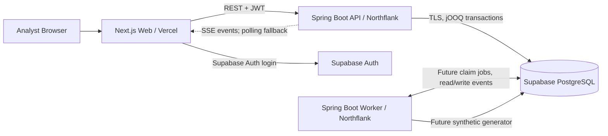
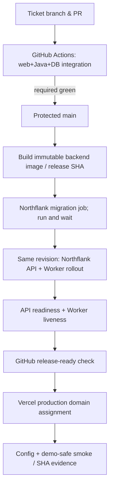

# Sistem Mimarisi — Uygulama Tasarımı

**Statü:** [HQ KARARI] Başlangıç mimarisi; scaffold ve CI doğrulandı, Northflank/Vercel/Supabase deployment hazırlığı incelemede ve live rollout henüz doğrulanmadı.
**Teknoloji listesi:** [`TECH_STACK.md`](TECH_STACK.md).  
**İş kuralları kaynakları:** [`DOMAIN.md`](DOMAIN.md), [`RULE_ENGINE.md`](RULE_ENGINE.md), [`UX.md`](UX.md) — iş semantiklerini burada tekrar yazmayın.

## 1. Topoloji

- **Modular monolith**: `backend/` içinde tek domain ve ortak kurallar; runtime'da iki process (`api`, `worker`) olarak deploy edilebilir. Bu bir mikroservis ağı değildir.
- Web (Next.js) **backend'in yerine geçmez**. Kritik business mutation sadece Spring API ile yürür.
- Frontend yalnız kendi tenant'ına ait verilere sunucu-kontrollü erişir. Supabase'in DB Data API'si bu ürünün transaction API'si değildir.
- Tek Postgres veri doğruluğu kaynağıdır; Redis / Kafka ilk sürümde zorunlu değildir.
- FND-003 yalnız Worker'ın sürekli runtime ve heartbeat temelini kurar. Job claim, synthetic generator ve fraud evaluation ilgili sonraki ticket'lar tamamlanana kadar aktif davranış değildir.
- Supabase Auth bağlantı/environment sözleşmesi FND-003'te hazırlanır; gerçek login/JWT doğrulama ve tenant authorization IAM-001 kapsamındadır.

### Runtime modları

| Mode | Yaşam döngüsü | HTTP / DB / migration davranışı |
|---|---|---|
| `APP_MODE=api` | Sürekli servis | HTTP + Actuator açar, DB readiness doğrular, Worker loop ve Flyway startup migration çalıştırmaz |
| `APP_MODE=worker` | Sürekli servis | Public business controller açmaz; DB bağlantısı gözlemlenir, redacted heartbeat üretir, Flyway çalıştırmaz |
| `APP_MODE=migrate` | Tek seferlik job | Flyway validation/migration çalıştırır ve başarı/hata exit code'u ile sonlanır; kalıcı HTTP servisi başlatmaz |

Üç mode aynı immutable image ve release SHA'dan çalışır. `APP_ENV` local/staging/production davranış sınırını belirler; production'da eksik zorunlu environment değeri lokal varsayılana sessizce düşmez.

## 2. Backend modül sınırları

Önerilen Java paket sınırları (dosya isimleri scaffold'ta kesinleşir):

| Domain modülü | Sorumluluk | Yasak bağımlılık/yan etki |
|---|---|---|
| `identity` | Auth principal, tenant membership, permission policy | Frontend'den gelen `tenantId`yi doğrulamadan kabul etmez |
| `transactions` | Ingestion, saklama, filter/sort/page, visible-IDs bulk action | UI pagination'ını DB transaction seti zannetmez |
| `rules` | Versioned rule AST, compile/validate, rule publication | Kullanıcı SQL veya runtime code execution yok |
| `evaluation` | Window queries, hit/event, cumulative score, mock block | Rule yazarının yorumunu hardcoded puana çevirmez |
| `investigations` | Assignment, lease, comments, status transitions, audit | Lock/ownership sadece frontend'de kontrol edilmez |
| `preferences` | Kullanıcı+kanal bazlı saved view | Diğer kullanıcıların ayarlarını etkilemez |
| `simulation` | Tekrar üretilebilir event paternleri ve rate kontrolü | Prod'a gerçek banka/veri entegrasyonu içermez |
| `shared` | Ortak temeller, typed IDs, zaman/hata sözleşmeleri | Genel amaçlı servis yığınına dönüşmez |

Her modülün HTTP/controller, service/domain, SQL/repository sınırı bellidir. Domain çekirdeği Spring HTTP veya Northflank'e bağlı olmayacak. **Ayrı microservice veya ağır Clean Architecture katmanları zorunlu değil**; test edilebilir servis ve package sınırları yeterli.

## 3. Yeni transaction değerlendirme yolu

1. Generator veya ingestion API, sentetik işlem ve **outbox/processing job** kaydını aynı DB transaction'ında ekler (at-least-once işleme dayanıklı).
2. Worker `FOR UPDATE SKIP LOCKED` ile işi claim eder; retry/backoff ve idempotency key kullanır. Aynı işlem iki kere puanlanamaz; unique constraint ve işlem atomikliği gerekir.
3. Aktif **tenant + channel** kural versiyonları doğrulanmış typed expression AST'den değerlendirilir.
4. Zamansal koşullar, değerlendirilen transaction'ın anchor alanlarından (ör. kart ID) PostgreSQL'de **tenant- ve channel-scoped**, indeksli jOOQ query'lerine dönüşür; izinli field/operator whitelist dışında sorgu kurulmaz.
5. Rule hits, score snapshot, review state, `payment_blocked` ve audit olayları tek mantıksal write transaction'ında kalıcılaştırılır. Worker başarısız olursa idempotent retry yapılır.
6. UI yeni kayıt var bilgisini SSE ile alabilir; SSE koparsa polling çalışır. Table açıkken kullanıcının seçimleri, filtreleri ve current page kendiliğinden resetlenmez.

**Gerçekçilik sınırı:** Zaman pencereli sorguları her transaction için Postgres üzerinde çalıştırmak **yüksek TPS ve çok aktif kuralda maliyetli** olabilir. 2 aylık akademik MVP için ölçülmüş veri boyutlarında uygundur; gelecekte Kafka/Flink, pre-aggregation veya materialized feature store'a geçiş için `evaluation` sınırı korunur. Milyonlarca satırın hızlı filtrelenmesi yalnız index/partition ve benchmark ile kanıtlanabilir; varsayılmayacak.

## 4. Veri modelleme ve sorgu disiplini

- Her tenant-scoped kayıtta `tenant_id`; işlemlerde `channel`, `event_time`, `ingested_at`, stable `transaction_id` ve kanalın tipli ortak alanları. Channel-specific alanlar sınırlı `jsonb` olarak düşünülebilir, **filtrelenen/aggregated sık alanlar typed/indexed kolonlarda** yer alır. Alan sözlüğü gelince son karar.
- İlk denenecek kompozit index örnekleri: `(tenant_id, channel, event_time DESC, id DESC)`, `(tenant_id, channel, card_id, event_time DESC)`, `(tenant_id, channel, receiver_account_number, event_time DESC)`. **Bu öneridir, migration/EXPLAIN ile doğrulanır**.
- API yoğun tabloda DB üzerinde cursor/keyset pagination öncelikli; kullanıcı `page n` navigasyonu için başlangıçta sınırlı offset/limit kabul edilebilir. Derin sayfalama sonucu nedeniyle keyset/cursor rotası planlı olsun.
- Para `BigDecimal`/Postgres `numeric` ve ISO currency kodu ile saklanır; float kullanılmaz. Farklı currency değerlerinin agregasyonda birleştirilmesi açık ürün kararıdır.
- `rule_version`, `rule_hit`, `evaluation`, `investigation_event`, `comment`, `view_preferences` audit ve ileride false-positive hesaplamak için ayrı kayıtlar barındırır. Geçmiş hit skorları yeni kural düzenlenince sessizce değiştirilmez.
- Kanonik table/field sözlüğü oluşmadan keyfi JSON kolon filtreleyen rule ticket'ı açma.

## 5. Eşzamanlı inceleme ve toplu karar

- Active investigation edit hakkı **DB transaction içinde atomik lease** ile verilir: `owner`, `token/version`, `expires_at`, heartbeat. Kilidi olmayan istekten status mutation/comment reddedilir; frontend salt okunur duruma düşer.
- Sekme kapanışı/çıkışta best-effort release; tarayıcı çökmesinde **lease TTL** ile geri kazanım. Tab hâlâ açıksa heartbeat; eski lease token ile yazma girişimi reddedilir.
- Assignment geçmişi ile şu anki lease ayrıdır. Final statü açılışla resetlenmez; `[DOMAIN.md](DOMAIN.md)` açık edge-case'leri korunur.
- Bulk API **visible/selected ID listesi** alır; actor/tenant/lock/status tekrar doğrulanır; kısmi başarı response sözleşmesi geliştirme ticket'ında netleştirilir. Sayfanın güncellenmesi kapsamı büyütmez.

## 6. Auth, tenant izolasyonu, RBAC

- **Supabase Auth (asimetrik JWT)** giriş akışını sağlar. Spring Security Resource Server JWKS ile signature/issuer/expiry/audience doğrular; backend'deki user/tenant membership ve permission tablosu **yetki kaynağıdır**. Client-provided tenant ve JWT'deki UI role alanları tek başına yetki değildir.
- Backend servis DB kullanıcısı **superuser/BYPASSRLS olmamalı**. Tenant ID server-side identity üzerinden çözülür. Her repository/query tenant koşulu ekler; mümkünse DB RLS **transaction-scoped** `SET LOCAL app.tenant_id` ile ikinci savunma katmanı olur. Pool üzerinden session state sızmasına izin verme; entegrasyon testleriyle tenant kaçakları denenir.
- Auth ve işlem kayıtlarında sahte ancak hassas görünebilecek alanlar için log redaction, en az yetki, HTTPS/TLS, secrets yalnız CI/hosting secret store.
- Gerçek bir kurum entegrasyonu, PCI-DSS/KVKK uyumluluğu veya bankacılık sertifikasyonu **bu prototipin sağladığı bir iddia değildir**.

## 7. Deployment / delivery düzeni

- **Hedef akışta** aynı main CI run'ındaki protected `release-ready` job'u `frontend-ci` ve `backend-ci` başarılarını bekler ve check bağlamı ile release SHA'nın aynı commit olduğunu doğrular. Northflank başlamadan önce ve provider smoke sonrasında GitHub'dan güncel main HEAD okunur; superseded veya doğrulanamayan revision fail-closed olur. Ardından immutable backend revision üretilir; Flyway job aynı revision ile başarıyla tamamlanmadan API/Worker rollout başlamaz. API readiness, `/actuator/info` exact release SHA, Worker canlılığı ve son latest-main guard görülmeden `release-ready` check başarılı olmaz. Vercel Git deployment production domain'i bu check'i bekleyen Deployment Check üzerinden alır. Manuel recovery farklı bir check adı taşır ve latest-main kısıtına bilinçli olarak tabi değildir. Harici provider entegrasyonları kurulmadığı için bu sıra bugün `VERIFIED` değildir.
- Northflank'in bağımsız image-change auto-deploy davranışı migration ile yarışmamalıdır; tek release workflow build → migrate/wait → aynı revision deploy sırasını yönetir. Detaylar [`DEPLOYMENT_RUNBOOK.md`](DEPLOYMENT_RUNBOOK.md)'dedir.
- Vercel Deployment Checks erişimi yoksa production candidate `--skip-domain` ile smoke edilir ve yalnız başarıdan sonra promote edilir; bağımsız production domain auto-promotion açılmaz.
- Vercel PR preview production DB credential'ı almaz ve production API'ye sessiz fallback yapmaz. Supabase staging ve production ayrı projelerdir. Developer Sandbox'taki iki service slotu API + Worker tarafından tüketildiğinden aynı anda iki ek staging JVM servisi varsayılmaz.
- İki ortamı karıştırma: local/demo verileri gerçek kurum verisi değildir. Migration geri dönüşü çoğu zaman ileri düzeltmeyle yapılır; otomatik destructive rollback'e güvenilmez.
- Production/demo sistem başlangıcında fail-fast config, `/actuator/health/readiness`, Worker heartbeat ve deploy smoke gerekir; başarısız deploy'da ticket kapanmaz, eski uyumlu image'a dönme veya fix-forward uygulanır.

## 8. Operasyonel riskler ve ölçülmesi gerekenler

- **Performans:** indeksli filter/pagination ve window COUNT/SUM için seed data üzerinde `EXPLAIN ANALYZE`, query süreleri, connection pool saturation; MVP için kapasiteler **ölçüm olmadan taahhüt edilmez**.
- **Lock yarışları:** aynı transaction'a iki actor eşzamanlı açma, expired lease yeniden sahiplenme, stale token ile mutation testleri.
- **İdempotency:** worker tekrar işlemesi, deploy sırasında restart, duplicate event ve rule version snapshot testleri.
- **Latency:** event üretiminden işlenmiş satıra ve UI'ya ulaşma süresini gösteren demo ölçümü; ilk hafta sayısal SLO uydurulmaz.
- **Maliyet/kota:** Northflank API+Worker iki sürekli service slotunun tamamını kullanır. Migration ve opsiyonel smoke job iki job adayıdır. 0.2 vCPU/512 MiB ve 0.5 vCPU/1024 MiB kaynak adaylarının ücretsiz erişimi ve JVM yeterliliği gerçek hesap/test olmadan varsayılmaz. Supabase DB/backup/compute ve Vercel plan sınırları ayrıca kontrol edilir.
- **Ortam sınıfı:** Northflank Developer Sandbox akademik canlı demo için değerlendirilebilir; ticari production SLA/compliance iddiası oluşturmaz.

## 9. Kesinleştirilmesi gereken iş kuralları (mimari blocker değil)

Risk review threshold kapsamı, `score > 100` gösterimi, blocked transaction review status'u, window event-time/current-event kuralı, currency/null semantics ve terminal bulk action edge-case'leri için [`DECISIONS.md`](DECISIONS.md) izlenir. Mimari bunları karara bağlanmış gibi kodlamaz.
