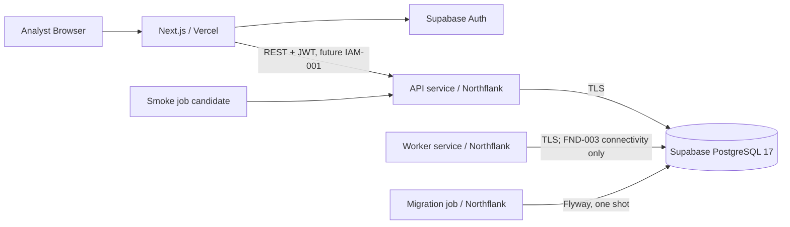

# Deployment Runbook — Northflank, Vercel ve Supabase

**Güncel:** 2026-10-29
**Statü:** FND-003 repository hazırlığı `REVIEW`; harici provider kurulumu, deployment, migration ve live smoke **UNVERIFIED**.
**Kapsam:** Deployment sözleşmesi ve operasyon adımları. Fraud engine, generator, transaction ingestion, tenant/RBAC modeli ve IAM-001 JWT implementation bu runbook'un kapsamı değildir.

Bu belge harici kaynak oluşturulduğuna dair kanıt değildir. Gerçek URL, provider revision, migration logu ve smoke sonucu Executor tarafından doğrulanmadan sistem `DEPLOYED`, otomatik release `VERIFIED` veya FND-003 `DONE` sayılmaz.

## 1. Hedef topoloji ve kaynak sınırı

- Vercel yalnız `frontend/` uygulamasını çalıştırır; Java API veya Worker Vercel Functions'a taşınmaz.
- Northflank API ve Worker iki ayrı sürekli service'tir ve aynı immutable backend image/revision kullanır.
- Northflank Developer Sandbox'taki **iki service slotunun tamamı API + Worker tarafından kullanılır**. Aynı anda production/demo ve staging için dört JVM service tanımlanmaz.
- Migration ve smoke, iki job slotu için adaydır. Smoke ayrı Northflank job yerine güvenli GitHub deployment workflow'unda yürütülürse ikinci job boş kalabilir; kota kullanmak zorunluluk değildir.
- Supabase harici DB/Auth sağlayıcısıdır; Northflank addon kotasını kullanmak zorunlu değildir.
- Developer Sandbox akademik canlı demo için değerlendirilir; ticari production SLA'sı veya compliance ortamı değildir.

## 2. Tek image ve runtime modları

Backend image Java 25 ile bir kez build edilir. API, Worker ve Migration farklı source/image üretmez; davranış yalnız runtime environment ile seçilir.

| Mode | Northflank kaynağı | Yaşam döngüsü | Flyway | Sağlık/gözlem |
|---|---|---|---|---|
| `APP_MODE=api` | Sürekli service | HTTP server sürekli çalışır | `false` | `/actuator/health/liveness`, `/actuator/health/readiness`; readiness DB'yi içerir. `/actuator/info` çalışan release SHA'yı verir |
| `APP_MODE=worker` | Sürekli service | Process SIGTERM'e kadar çalışır; FND-003'te business job işlemez | `false` | Secret içermeyen periyodik heartbeat; mode, environment, zaman, DB durumu ve release SHA |
| `APP_MODE=migrate` | Manual/release job | Flyway validate/migrate sonrası `0`; hatada non-zero ile çıkar | `true` | Job exit code, log ve `flyway_schema_history` version/checksum kanıtı |

Kurallar:

- API Worker loop başlatmaz; Worker public business controller yayınlamaz.
- Worker heartbeat fraud processing, queue consumer veya transaction generator değildir.
- API/Worker startup migration çalıştırmaz. `SPRING_FLYWAY_ENABLED=true` yalnız migrate job'a verilir.
- Image entrypoint graceful shutdown sinyalini doğrudan JVM'e iletir. API ve Worker SIGTERM süresi içinde kapanmalıdır.
- Image OCI label ve runtime logunda `APP_RELEASE_SHA` bulunabilir; credential, JDBC password veya JWT loglanmaz.
- Production modları eksik zorunlu environment değerlerinde localhost/local credential varsayılanına düşmez.

## 3. Environment variable sözleşmesi

Örnekler format göstermek içindir; gerçek project ref, host, key veya parola içermez. Secret değerler yalnız provider secret store/environment group üzerinden verilir.

### 3.1 Backend ve ortak runtime

| Ad | Kullanan servis | Zorunluluk / ortam | Secret | Güvenli örnek veya kural |
|---|---|---|---|---|
| `APP_MODE` | API, Worker, Migration | Her deploy'da zorunlu | Hayır | `api`, `worker`, `migrate` |
| `APP_ENV` | API, Worker, Migration | Deploy'da zorunlu | Hayır | `staging` veya `production`; local için `local` |
| `SERVER_PORT` | API; internal HTTP varsa Worker | API'de zorunlu/platform portuyla aynı | Hayır | `8080` |
| `SPRING_PROFILES_ACTIVE` | API, Worker, Migration | Deploy'da zorunlu | Hayır | `production` veya `staging`; `APP_ENV` ile çelişmez |
| `SPRING_DATASOURCE_URL` | API, Worker, Migration | Deploy'da zorunlu | Evet / hassas | `jdbc:postgresql://<dashboard-host>:5432/postgres?sslmode=require`; host Dashboard Connect ekranından kopyalanır |
| `SPRING_DATASOURCE_USERNAME` | API, Worker, Migration | Deploy'da zorunlu | Evet | `<db-role>` veya session pooler için `<role>.<project-ref>` |
| `SPRING_DATASOURCE_PASSWORD` | API, Worker, Migration | Deploy'da zorunlu | Evet | Yalnız secret store; örnek değer commit edilmez |
| `SPRING_FLYWAY_ENABLED` | API, Worker, Migration | Zorunlu invariant | Hayır | API/Worker `false`; Migration `true` |
| `SPRING_DATASOURCE_HIKARI_MAXIMUM_POOL_SIZE` | API, Worker | Deploy'da zorunlu tuning | Hayır | Ölçümle belirlenen küçük tam sayı; toplam DB limitini aşmaz |
| `SUPABASE_URL` | API auth hazırlığı | Production/staging config sözleşmesi | Hayır | `https://<project-ref>.supabase.co` |
| `SUPABASE_JWT_ISSUER` | API auth hazırlığı | Production/staging config sözleşmesi | Hayır | Dashboard'dan türetilen HTTPS issuer |
| `SUPABASE_JWKS_URL` | API auth hazırlığı | Production/staging config sözleşmesi | Hayır | HTTPS JWKS endpoint |
| `SUPABASE_JWT_AUDIENCE` | API auth hazırlığı | Production/staging config sözleşmesi | Hayır | Onaylanan audience; tahmin edilmez |
| `APP_CORS_ALLOWED_ORIGINS` | API | Browser API çağrısından önce zorunlu | Hayır | Virgülle ayrılmış kesin Vercel origin'leri; `*` production'da yasak |
| `APP_RELEASE_SHA` | API, Worker, Migration | Staging/Production zorunlu | Hayır | Tam, küçük harfli 40 karakter Git commit SHA; secret değildir |
| `APP_WORKER_HEARTBEAT_INTERVAL` | Worker | Opsiyonel tuning | Hayır | Başlangıç `30s`; smoke birkaç gerçek döngüyü bekler |
| `APP_WORKER_HEARTBEAT_FILE` | Worker | Container healthcheck kullanıyorsa zorunlu | Hayır | Yazılabilir runtime path; başlangıç `/tmp/kostak-worker-heartbeat` |
| `APP_WORKER_HEARTBEAT_MAX_AGE_SECONDS` | Worker | Opsiyonel tuning | Hayır | Healthcheck'in kabul edeceği azami dosya yaşı; varsayılan `90`, heartbeat interval'dan büyük olmalıdır |
| `APP_WORKER_SHUTDOWN_TIMEOUT` | Worker | Opsiyonel tuning | Hayır | Başlangıç `10s`; Northflank termination grace süresini aşmaz |
| `JAVA_TOOL_OPTIONS` | API, Worker, Migration | Kaynak planına göre opsiyonel | Hayır | Container memory ölçümüne göre JVM seçenekleri; secret eklenmez |

`SUPABASE_*` değişkenlerinin doğrulanması, gerçek JWT signature/issuer/audience doğrulamasının uygulandığı anlamına gelmez. Spring Security resource-server ve backend tenant/permission denetimi IAM-001'de tamamlanır.

### 3.2 Frontend / Vercel

| Ad | Ortam | Zorunluluk | Secret | Kural |
|---|---|---|---|---|
| `NEXT_PUBLIC_API_BASE_URL` | Preview, Production | API entegrasyonu kullanıldığında zorunlu | Hayır; tarayıcıya açıktır | Preview yalnız non-prod API/degraded moda; Production yalnız production API'ye gider |
| `NEXT_PUBLIC_SUPABASE_URL` | Preview, Production | IAM entegrasyonu başladığında zorunlu | Hayır; tarayıcıya açıktır | Her ortam kendi Supabase projesini kullanır |
| `NEXT_PUBLIC_SUPABASE_PUBLISHABLE_KEY` | Preview, Production | IAM entegrasyonu başladığında zorunlu | Hayır; publishable browser key | `service_role`, secret API key veya DB password asla kullanılmaz |
| `ENABLE_EXPERIMENTAL_COREPACK` | Preview, Production build | Exact pnpm için zorunlu | Hayır | `1`; `packageManager: pnpm@11.24.0` değerini kullandırır |

`NEXT_PUBLIC_*` değerleri build çıktısında ve tarayıcıda görülebilir. Bu prefix altında hiçbir secret tutulmaz.

## 4. Supabase PostgreSQL bağlantısı ve migration

### 4.1 Sürüm matrisi

- Provision edilecek Supabase hedefi PostgreSQL **17**'dir.
- Mevcut local/CI Testcontainers ve Compose PostgreSQL **18.3** testi korunur.
- Flyway V1 migration, pgJDBC `42.7.14` ve jOOQ sorgusu her iki major üzerinde doğrulanır. Bir majorın geçmesi diğerinin kanıtı sayılmaz.
- Spring Boot 4.1.1'in yönettiği pgJDBC `42.7.13`, security patch nedeniyle `42.7.14` olarak explicit override edilir. Bu override Flyway veya jOOQ'yu elle pinlemez; ikisi Boot-managed kalır.
- Staging ve production iki ayrı Supabase projesidir. Production üzerinde yetkisiz destructive test/migration yapılmaz.

### 4.2 Endpoint seçimi

1. Northflank'in ilgili projede IPv6 egress'i gerçek bağlantıyla doğrulanırsa persistent JVM için Supabase direct endpoint kullanılır.
2. IPv6 doğrulanmaz veya direct endpoint erişilemezse Dashboard'daki **session pooler** IPv4 endpoint'i kullanılır.
3. Transaction pooler persistent API/Worker için varsayılan değildir; prepared statement/session davranışı nedeniyle ayrıca kanıt olmadan seçilmez.
4. Host, port ve pooler username elle tahmin edilmez; Supabase Dashboard → Connect ekranından alınır.

### 4.3 TLS

- Minimum bağlantı parametresi `sslmode=require` olup production'da kapatılamaz.
- `require` encryption sağlar ancak hostname/CA doğrulamaz. Supabase CA güven zinciri image'a güvenli biçimde eklenebiliyorsa `sslmode=verify-full` + CA dosyası tercih edilir.
- CA dosyası secret değildir ancak doğrulanmış kaynaktan alınır; image/secret-file mekanizması ve path runbook kanıtına yazılır.
- Hata/log mesajları tam JDBC URL, username/password veya token yazmaz.

### 4.4 Pool ve fail-fast

- API ve Worker ayrı Hikari pool açar; toplam bağlantı sayısı Supabase proje limitine göre hesaplanır.
- 0.2 vCPU/512 MiB başlangıç testi için pool ve JVM heap küçük tutulur; 0.5 vCPU/1024 MiB tercih adayıdır. Her iki planın ücretsiz erişimi **UNVERIFIED**.
- Production/staging başlangıcında eksik URL/username/password ve geçersiz connection fail-fast olmalıdır.
- API readiness DB kapalıyken `DOWN`/non-ready, DB erişilebilirken `UP` döner. Response connection ayrıntısı göstermez.
- Worker bağlantı problemi gözlemlenebilir şekilde hata verir; secret loglamaz ve process'in sahte healthy görünmesine izin verilmez.

### 4.5 Migration release adımı

1. Aynı image/revision önce staging PostgreSQL 17 üzerinde migration job ile doğrulanır.
2. Production backup/recovery durumu kontrol edilir.
3. Production migration job `APP_MODE=migrate`, `SPRING_FLYWAY_ENABLED=true` ile çalıştırılır.
4. Job non-zero exit ederse workflow durur; API/Worker/Vercel rollout yapılmaz.
5. Başarıda `flyway_schema_history` current version/checksum ve job revision kaydedilir.
6. Destructive otomatik rollback kullanılmaz. Gerekirse backup recovery; normal durumda yeni versioned fix-forward migration hazırlanır. Mevcut `V1` değiştirilmez.

## 5. Northflank kurulum sözleşmesi

### 5.1 Hesap/proje preflight

- Plan: Developer Sandbox; ücretsiz erişim ve billing durumu gerçek hesapta doğrulanır.
- Region: Europe West / London, API ID `europe-west`. Proje region'ı oluşturulduktan sonra değiştirilemediği için creation öncesi doğrulanır.
- Kota: 2 service, 2 job, 1 addon. API + Worker tüm service slotlarını tüketir.
- Kaynak adayları: `nf-compute-20` (0.2 vCPU/512 MiB) yalnız test adayı; `nf-compute-50` (0.5 vCPU/1024 MiB) tercih edilen başlangıç adayı. Ücretsiz/account erişimi ve JVM yeterliliği **UNVERIFIED**.
- Instance count: API `1`, Worker `1`; autoscaling veya ikinci replica ölçüm/bütçe olmadan açılmaz.

### 5.2 Build alanları

| Northflank alanı | Değer |
|---|---|
| Repository | `kostak-fraud/kostak-fraud-tool` — GitHub erişimi kurulunca |
| Production branch | `main` |
| Build context | `backend` |
| Dockerfile path | `/backend/Dockerfile` |
| Build strategy | Repository Dockerfile; buildpack kullanılmaz |
| Artifact | Tek immutable image; commit SHA/revision kaydedilir |

Java 25 base tag'i gerçek build ile doğrulanır. Build secret image layer'ına kopyalanmaz; runtime secret build argümanı yapılmaz.

### 5.3 Service ve job alanları

**API service**

- Image: release workflow'un ürettiği exact revision.
- Runtime: image entrypoint; `APP_MODE=api`, `SPRING_FLYWAY_ENABLED=false`.
- Public port: `SERVER_PORT` ile aynı, başlangıç değeri `8080`.
- Liveness: `/actuator/health/liveness`.
- Readiness/traffic: `/actuator/health/readiness`.
- Start period/timeout değerleri gerçek cold-start ölçümüne göre ayarlanır.

**Worker service**

- Image: API ile aynı exact revision.
- Runtime: image entrypoint; `APP_MODE=worker`, `SPRING_FLYWAY_ENABLED=false`.
- Public port açılmaz. Internal health HTTP uygulanırsa yalnız private/internal port kullanılır.
- Process'in çalışması, DB connectivity durumu ve birkaç heartbeat döngüsü log/metric ile doğrulanır. Worker service/Compose healthcheck'i image içindeki `/app/worker-healthcheck.sh` komutunu kullanır; dosyanın düzenli, symlink olmayan, `db_status=UP` içeren ve `APP_WORKER_HEARTBEAT_MAX_AGE_SECONDS` sınırından yeni olmasını ister. Aynı image API/Migration için de kullanıldığından global Dockerfile healthcheck tanımlanmaz; API'nin HTTP probe'ları provider'da ayrıca ayarlanır.
- SIGTERM gönderildiğinde graceful shutdown logu ve temiz exit gözlenir.

**Migration job**

- Image: rollout yapılacak exact revision.
- Runtime: image entrypoint; `APP_MODE=migrate`, `SPRING_FLYWAY_ENABLED=true`.
- Manual/release-flow job; schedule veya sürekli restart yok.
- Retry limiti kontrollü, concurrency `Forbid`; tek schema'ya eşzamanlı iki migration çalıştırılmaz.
- Başarılı exit `0`; hata non-zero ve workflow stop.

**Smoke job adayı**

- API readiness, release SHA ve izin verilen demo-safe endpoint'leri doğrular.
- Production credential gerektiren test eklenirse secret yalnız trusted deployment context'te verilir.
- Aynı kontrol GitHub deployment workflow'unda güvenli yürütülürse ayrı Northflank job oluşturmak gerekmez.

### 5.4 Secret grupları ve environment mapping

- Staging ve production environment/secret grupları ayrıdır; aynı adlar farklı değerlere map edilir.
- DB credential yalnız API, Worker ve Migration'a; frontend'e verilmez.
- Supabase publishable browser değerleri Vercel ortamlarına ayrı ayrı girilir.
- GitHub PR workflow'u, Vercel Preview ve build logları production DB password/Northflank token alamaz.
- Secret rotation sonrası servisler kontrollü rollout edilir; eski değer log/handoff'a kopyalanmaz.

### 5.5 Release workflow

Tek-sorumlu otomasyon iki katmandan oluşur:

1. `.github/workflows/ci.yml` içindeki `release-ready`, aynı `main` push çalıştırmasının `frontend-ci` ve `backend-ci` job'larını `needs` ile bekler. Ayrı bir `workflow_run` bağlamı kullanılmaz.
2. Job `RELEASE_SHA`, `GITHUB_SHA` ve checkout SHA'nın birebir aynı olduğunu doğrular. Böylece art arda iki main commit'i geldiğinde check her zaman test edilen kendi revision'ına bağlı kalır.
3. `DEPLOYMENT_AUTOMATION_ENABLED=true` değilse `release-ready` job'u `skipped` olur ve harici release tetiklenmez.
4. Release job'u GitHub'ın protected `production` environment'ında çalışır; job/check adı tam olarak `release-ready` kalır.
5. Workflow, `NORTHFLANK_API_TOKEN` secret'ı ve aşağıdaki repository variables ile Northflank workflow API'sini tetikler:
   - `NORTHFLANK_PROJECT_ID`
   - `NORTHFLANK_WORKFLOW_ID`
   - `PRODUCTION_API_BASE_URL`
6. Northflank workflow'a `COMMIT_SHA` ve `BRANCH` arguments geçirilir. Trigger edilen run başarı/hata sonucuna kadar poll edilir; fire-and-forget başarı sayılmaz.

`.github/workflows/release.yml` içindeki `workflow_dispatch` yalnız kontrollü backend yeniden çalıştırma/kurtarma yoludur; seçilen full SHA'nın `origin/main` geçmişinde olduğu doğrulanmadan release başlatmaz. Job/check adı bilinçli olarak `manual-release`tir ve Vercel'in beklediği `release-ready` check'ini üretemez. Önceki revision'a manuel backend dönüşü frontend'i otomatik promote etmez; uyumluluk incelemesinden sonra karşılık gelen Vercel rollback/promote ayrıca ve açıkça yapılır. Tercih edilen genel rollback, `main` üzerinde revert/fix-forward commit'i oluşturup normal exact-SHA kapısından geçmektir.

Northflank workflow'un kendi sırası:

1. `main` commit SHA için backend image build başlat ve completion bekle.
2. Exact image'ı migration job'a deploy et.
3. Migration job'u çalıştır ve completion bekle.
4. Başarı koşuluyla exact image'ı API ve Worker'a deploy et.
5. API readiness ve Worker process/heartbeat condition'ını bekle.
6. GitHub release workflow, `PRODUCTION_API_BASE_URL` üzerinden API readiness ile `/actuator/info` release SHA smoke'unu yapar.
7. Northflank run başarılı olur, workflow arguments içindeki SHA/branch istekle eşleşir, readiness `UP` döner ve API'nin verdiği tam SHA istenen commit'le aynı olursa `release-ready` check başarılı olur.

URL, provider revision, commit SHA ve schema version release kanıtı olarak ayrıca kaydedilir. Mevcut GitHub workflow bu kanıtların tamamını tek başına persist ettiğini iddia etmez.

Vercel Git integration Production Branch `main` olarak kalır. Vercel Production Deployment Check, production domain assignment/promote adımını aynı commit'teki `release-ready` check başarılı olana kadar bekletir. Deployment Checks özelliğinin plan/hesap erişimi **UNVERIFIED**'dır.

Deployment Checks kullanılamazsa güvenli alternatif bağımsız Vercel auto-promotion değildir: trusted release job önce `vercel --prod --skip-domain` ile domain'e bağlanmamış production candidate üretir, candidate URL üzerinde smoke çalıştırır ve yalnız Northflank + Vercel smoke başarılıysa `vercel promote` ile production domain'e geçirir. Gerekli Vercel token/project/team değerleri yalnız protected `production` environment secret/variables içinde tutulur.

Northflank service/job başına bağımsız “deploy latest on image change” açılırsa migration bitmeden rollout olabilir; Vercel production domain'i de backend hazır olmadan değişebilir. Bu nedenle provider-level independent CD/promotion açılmaz.

### 5.6 Log, restart ve recovery

- Build, migration job, API ve Worker logları release SHA ile filtrelenir.
- API restart öncesi readiness ve aktif deployment revision kaydedilir.
- Worker restart idempotent olmalıdır; FND-003 heartbeat dışında business side effect üretmez.
- Migration başarısızlığında API/Worker eski revision'da kalır; job logu ve Flyway history incelenir.
- Application regression'da schema ile uyumlu önceki image'a dönülür. Schema rollback otomatik image rollback'e bağlanmaz.

## 6. Vercel monorepo kurulumu

| Ayar | Değer / doğrulama |
|---|---|
| Git repository | `kostak-fraud/kostak-fraud-tool`; GitHub organization izni ayrı kontrol edilir |
| Root Directory | `frontend` |
| Framework Preset | Next.js |
| Production Branch | `main` |
| Node.js | Vercel project setting `24.x`; platform exact patch garanti etmez |
| Package manager | `packageManager` alanından exact `pnpm@11.24.0` |
| Corepack | Preview ve Production'da `ENABLE_EXPERIMENTAL_COREPACK=1` |
| Install Command | Override **yok**; custom `pnpm install` girilmez |
| Build Command | Framework default / `pnpm build`; gereksiz override yok |
| Output Directory | Next.js default; custom output yok |

29 Ekim 2026 canlı Vercel dokümantasyonu pnpm 6–12 desteğini listeler. Buna rağmen exact 11.24.0 davranışı yalnız gerçek Preview ve Production build loguyla kanıtlanır. Node tarafında Vercel 24.x majorını yönetir; local/CI exact 24.20.0 ile provider patch'inin birebir aynı olduğu iddia edilmez.

### Preview / Production izolasyonu

- Production env yalnız `main` production deployment'ına uygulanır.
- Preview env ayrı Supabase projesi/non-prod API kullanır veya frontend API entegrasyonu yoksa açıkça degraded/read-only kalır.
- Preview'da `NEXT_PUBLIC_API_BASE_URL` eksik veya hatalıysa production API'ye fallback yapılmaz; kullanıcıya/developer loguna güvenli config hatası verilir.
- Production PostgreSQL credential, `service_role`, Supabase secret key, Northflank token veya GitHub deployment token Vercel frontend ortamına girilmez.
- IAM-001 tamamlanmadığı için publishable Auth config'in bulunması login akışının çalıştığı anlamına gelmez.

### GitHub organization checklist

- Vercel GitHub App'in doğru organization ve yalnız gerekli repository izni doğrulanır.
- Production Branch `main` ve preview branch davranışı dashboard'da ekran/log kanıtıyla kaydedilir.
- Main protection ve `frontend-ci` / `backend-ci` required checks korunur.
- Deployment yaratma yetkisinin PR/fork actorlarına production secret vermediği doğrulanır.

## 7. CI/CD ve release sırası

Mevcut required check adları değişmez:

- `frontend-ci`
- `backend-ci`

Hedef main release sırası:

1. PR quality checks.
2. Protected `main` merge ve başarılı `CI` workflow run.
3. Aynı CI run'ında `release-ready` job'unun iki required job'u beklemesi; exact `GITHUB_SHA` eşleşmesi, `DEPLOYMENT_AUTOMATION_ENABLED=true` ve protected `production` environment gate.
4. `COMMIT_SHA`/`BRANCH` ile Northflank workflow trigger ve completion poll.
5. Immutable image/revision build.
6. Controlled Flyway migration job.
7. Exact revision API/Worker rollout ve API readiness + Worker liveness.
8. GitHub API readiness + exact release SHA smoke; başarılı `release-ready` check.
9. Vercel Git deployment'ın Deployment Check sonrası production domain assignment'ı; özellik yoksa staged `--skip-domain` candidate → smoke → promote alternatifi.
10. URL, schema version ve GitHub/Northflank/Vercel revision kaydı.

`release-ready`, mevcut required PR check'leri `frontend-ci` ve `backend-ci`nin yerine geçmez; production release gate'idir. Harici Northflank/Vercel/Supabase token ve project ID'leri mevcut değilse otomasyon hazırlanabilir ama çalışmış gibi raporlanmaz. Production secret kullanan workflow `pull_request` veya untrusted fork context'inde çalışmaz. Provider dashboard'da yapılan adımlar tarih, actor ve revision ile handoff'a yazılır.

## 8. Doğrulama ve smoke kanıtı

### Repository/local kanıtı

- Backend `./mvnw -B verify`.
- Release workflow sözleşme testleri: automatic gate aynı CI SHA'sına bağlıdır; manuel recovery `release-ready` adı üretemez.
- Frontend frozen install, lint, typecheck, test ve build.
- Docker image build ve non-root runtime.
- API mode startup + liveness/readiness + `/actuator/info` release SHA.
- Worker birkaç heartbeat döngüsü boyunca çalışır; graceful shutdown.
- Migration mode başarı exit'i; API/Worker startup'ta Flyway çalışmadığı kanıtlanır.
- Missing config ve invalid DB fail-fast.
- PostgreSQL 17 ve mevcut 18.3 migration/integration testi.
- 512 MiB test adayı ve 1024 MiB tercih adayında JVM memory gözlemi.
- Secret leak taraması ve `git diff --check`.

### Live smoke kanıtı

- Northflank API URL + `/actuator/health/liveness` ve `/readiness` HTTP status/body.
- Worker service revision, running process ve redacted heartbeat timestamps.
- Migration job revision, exit code ve schema version/checksum.
- Vercel production URL, deployment ID/revision ve visible release SHA.
- Preview deployment'ın production API/DB'ye gitmediğinin network/env kanıtı.
- Commit SHA ile üç provider revision'ının eşleşmesi.

Gerçek URL yoksa placeholder URL kanıt sayılmaz. Auth flow IAM-001 öncesinde smoke'un başarılı maddesi olarak işaretlenmez; yalnız config contract/fail-fast doğrulanır.

## 9. Rollback, recovery ve fix-forward

- **Migration öncesi:** Supabase backup/recovery kapasitesi ve son kullanılabilir recovery noktası doğrulanır.
- **Migration hatası:** rollout durur; job log/Flyway history incelenir. V1 veya uygulanmış migration düzenlenmez.
- **Schema düzeltmesi:** Tercih yeni versioned fix-forward migration'dır. Destructive otomatik rollback yoktur.
- **API/Worker regression:** Schema ile uyumlu önceki immutable image revision'a dönülür ve health tekrar doğrulanır.
- **Vercel regression:** Önceki production deployment'a rollback/promote yapılır; backend/schema uyumu kontrol edilir.
- **Secret sızıntısı:** Secret derhal rotate edilir, ilgili deployment/log/artifact erişimi incelenir ve yeni revision rollout edilir; değer handoff'a yazılmaz.

## 10. External setup ve bilinen riskler

### Executor tarafından hâlâ yapılması gerekenler

- Northflank plan/billing, GitHub bağlantısı, `europe-west` projesi, build/service/job/workflow ve secret group kurulumu.
- GitHub repository variables `DEPLOYMENT_AUTOMATION_ENABLED`, `NORTHFLANK_PROJECT_ID`, `NORTHFLANK_WORKFLOW_ID`, `PRODUCTION_API_BASE_URL`; protected `production` environment ve `NORTHFLANK_API_TOKEN` secret kurulumu.
- Supabase staging + production PostgreSQL 17/Auth projeleri, DB role/password, SSL enforcement/CA ve endpoint seçimi.
- Vercel project bağlantısı, GitHub organization izni, Preview/Production env ve Corepack setting'i; `release-ready` Production Deployment Check'in plan/hesapta bulunması ve doğru repository check'e bağlanması.
- Deployment Checks yoksa protected release ortamında Vercel staged CLI `--prod --skip-domain` → smoke → `promote` alternatifinin token/project/team ayarları.
- Provider otomasyon sırası, gerçek deploy, migration, live smoke ve evidence linkleri.

### Açık riskler / UNVERIFIED

- Northflank Developer Sandbox free erişimi, `nf-compute-20`/`nf-compute-50` uygunluğu ve 512 MiB/1024 MiB JVM davranışı gerçek hesapta doğrulanmadı.
- Northflank IPv6 egress doğrulanmadı; bu yüzden direct Supabase endpoint kesin seçim değildir.
- Supabase PostgreSQL 17 provider integration ve CA/`verify-full` yolu live ortamda doğrulanmadı; mevcut CI PostgreSQL 18.3 kullanır.
- Vercel exact pnpm 11.24.0 Preview ve Production build'i `ENABLE_EXPERIMENTAL_COREPACK=1` ile henüz çalıştırılmadı.
- GitHub `release-ready` → Northflank workflow poll → Vercel Deployment Check/domain assignment sırası provider üzerinde henüz kurulmadı; Deployment Checks plan/hesap erişimi **UNVERIFIED**.
- Supabase Auth/JWT doğrulaması ve tenant/RBAC IAM-001 kapsamındadır.
- `backlog/FND-002.md` statüsü, CI commit ve handoff kanıtına rağmen hâlâ `PLANNED`; FND-003 bu metadata'yı sessizce değiştirmez, Executor ayrıca çözmelidir.
- FND-003 `REVIEW` statüsü repository hazırlığını ifade eder; live kanıt olmadan `DONE` değildir.

## Resmî sağlayıcı referansları

- Northflank build/deploy: https://northflank.com/docs/v1/application/getting-started/build-and-deploy-your-code
- Northflank workflows: https://northflank.com/docs/v1/application/release/configure-workflows
- Northflank jobs: https://northflank.com/docs/v1/application/run/run-an-image-once-or-on-a-schedule
- Northflank regions: https://northflank.com/docs/v1/application/run/deploy-to-a-region
- Northflank plan ve quota: https://northflank.com/docs/v1/application/billing/resource-plans-and-quotas
- Vercel build/root settings: https://vercel.com/docs/builds/configure-a-build
- Vercel package managers: https://vercel.com/docs/package-managers
- Vercel Node.js versions: https://vercel.com/docs/functions/runtimes/node-js/node-js-versions
- Vercel environment variables: https://vercel.com/docs/environment-variables
- Supabase PostgreSQL connections: https://supabase.com/docs/guides/database/connecting-to-postgres
- Supabase SSL enforcement: https://supabase.com/docs/guides/platform/ssl-enforcement
- Supabase JWT/JWKS: https://supabase.com/docs/guides/auth/jwts
